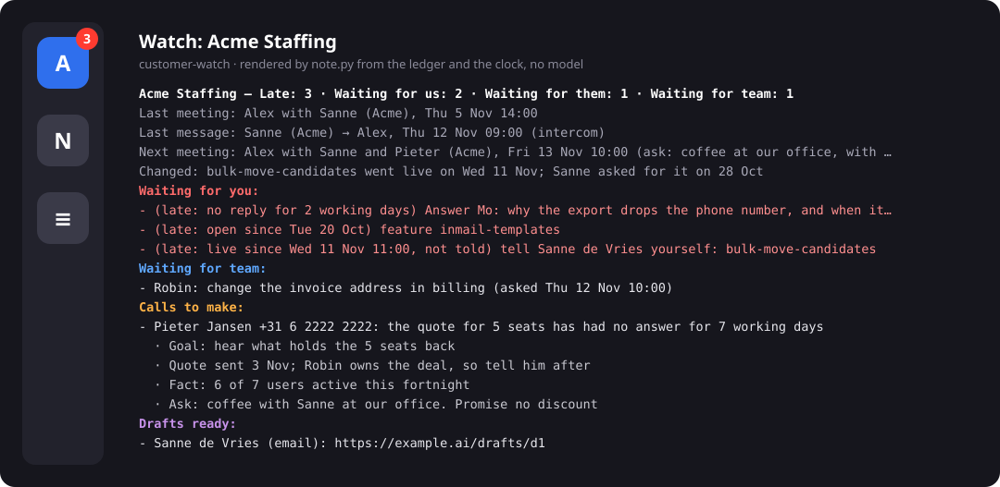

# customer-watch

**Give every customer their own Claude Code session.** It knows every mail, chat, ticket, call and
meeting with that customer, tells you what is late, drafts your replies with the one next step
that builds the relationship, and proposes the calls worth making, with notes. It never sends.
You do.



[](https://github.com/janwilmake/customer-watch/actions/workflows/test.yml)
[](LICENSE)

## For product engineers and FDEs

With Claude Code you fix a customer's bug in hours. The customer still hears about it days later,
or never. Their message sits in one of five inboxes. The promise you made on a call lives in a
transcript nobody reads again. And the trust you build belongs to the company's CRM, not to you.

customer-watch closes that loop:

- **Nothing slips.** A shell gate checks every channel once a minute, with no model call. When the
  customer writes, calls or meets you, it wakes that customer's session, which reads it and updates
  the ledger: who has the ball, what you promised and by when, what they wished for.
- **Late is computed, not guessed.** No answer for 24 working hours, a promise past its date, a
  fix that went live but nobody told the reporter: each is a red badge. Weekends do not count.
- **Every draft carries the next best step.** Before a draft, `nextstep.py` reads your history with
  that person and picks one step: tell them their fix is live, invite them for a coffee at your
  office, propose 15 minutes, ask for an intro. It also knows when not to ask: never while you owe
  them something late, never in a bad-news mail, and not twice in one month.
- **Calls when a call is better.** A quote unanswered for a week, a promise two days late, usage
  that halves at the champion: the session proposes the call, with notes you can read with the
  phone in your hand.
- **A daily brief and a weekly team update.** `report.py` reads every ledger: each morning, what
  is late, the calls to make and the drafts to send; each week, status per customer, the wishes
  most customers asked for, and who needs attention, safe to post in a team channel.
- **Your trust, measured.** `trust.py` counts your own personal touches, asks and their answers,
  fixes told and how fast. The relationships are yours; the ledgers stay your employer's.

## Try it in 10 seconds

No accounts needed. The demo home holds two fictional customers, and the clock is pinned:

```bash
git clone https://github.com/janwilmake/customer-watch && cd customer-watch
export CUSTOMER_WATCH_HOME=examples/demo CUSTOMER_WATCH_NOW=2026-11-12T15:00:00Z
python3 note.py demo                        # the note: Late, calls to make, drafts, trust moves
python3 nextstep.py acme-staffing           # the next best step per contact, and why
python3 trust.py --days 30                  # your trust work, in numbers
```

## Install

Paste this into Claude Code:

```text
Install customer-watch for me. Follow "Install steps" in https://github.com/janwilmake/customer-watch/blob/main/README.md
```

### Install steps

1. Clone the repo and link it as a skill:
   `git clone https://github.com/janwilmake/customer-watch ~/code/customer-watch && ln -s ~/code/customer-watch ~/.claude/skills/customer-watch`
2. Create the watch home: `python3 ~/.claude/skills/customer-watch/init.py`. It copies the
   templates to `~/.customer-watch` (or `$CUSTOMER_WATCH_HOME`) and never overwrites a file.
3. Install [agent-codemode](https://github.com/janwilmake/agent-codemode): the gate calls your
   MCP servers from the shell with the logins Claude Code already has. `npm install -g agent-codemode`.
4. Fill in `~/.customer-watch/me.json` and `me.md`: who you are, your office, your booking link,
   how you write.
5. Connect your channels in `~/.customer-watch/config.json`: see [Connect your channels](#connect-your-channels).
   Each one is optional.
6. In Claude Code: `/customer-watch Acme`. One session per customer, or `/customer-watch rest` for
   one session that watches everyone else.

Optional: [Roost](https://github.com/janwilmake/roost) shows each session as a tile with the badge
on the edge of your Mac screen. Without Roost, every render writes `sessions/<id>/note.md`.

## Connect your channels

Pick per channel. Mix freely: `"adapter": ["adapters/imap", "adapters/ical"]`.

| Channel | Ready | Needs | Speed |
|---|---|---|---|
| Email | [`adapters/imap`](adapters/imap/ADAPTER.md) | an app password (Gmail, Microsoft 365, Fastmail, iCloud) | within a minute; drafts go to your own Drafts folder |
| Meetings | [`adapters/ical`](adapters/ical/ADAPTER.md) | your calendar's secret iCal address (Google, Outlook) | within minutes; repeating and moved meetings included |
| Email, calls, meetings, notes | [`adapters/hubspot`](adapters/hubspot/ADAPTER.md) (untested, PRs welcome) | a HubSpot private app token | within a minute |
| Support chat | built in | Intercom's MCP server | within a minute |
| Team and Slack Connect channels | built in | Slack's MCP server | within a minute |
| Anything else | connector mode | any MCP connector your Claude Code session has: Gmail, Calendar, Fireflies, Gong, Attio… | every full check, 1–6 hours |

The ready adapters use Python's standard library only. Their secrets come from the macOS
Keychain, the environment or your password manager's CLI, never from `config.json` in clear text:

```json
"adapter": ["adapters/imap", "adapters/ical"],
"imap": {"host": "imap.gmail.com", "user": "you@company.com", "password": {"keychain": "customer-watch-imap"}},
"ical": {"url": {"keychain": "customer-watch-ical"}},
"connectors": ["fireflies"],
"full_tick_hours": 2
```

**Connector mode** covers what no adapter reads yet. The gate runs outside Claude, so it cannot
reach claude.ai connectors; the session can. On its full check it reads each listed connector for
what changed with this customer, and treats each new thing as an item. Slower and costs tokens,
so it suits a handful of customers.

## How it works

```text
 every 60 s, no model                 only when something is new
 ┌──────────────┐  NEW item  ┌─────────────────────────────┐   ┌──────────────────────┐
 │   gate.py    │──────────▶ │ the customer's Claude Code  │──▶│ ledger.json          │
 │ adapter      │   wakes    │ session (SKILL.md):         │   │ ball, promises,      │
 │ Intercom     │            │ read it, update the ledger, │   │ wishes, trust_log,   │
 │ Slack        │            │ draft with nextstep.py      │   │ drafts, calls        │
 └──────────────┘            └─────────────────────────────┘   └──────────┬───────────┘
                                                                          │ note.py
                                                              ┌───────────▼───────────┐
                                                              │ note: Late badge,     │
                                                              │ calls, drafts, trust  │
                                                              └───────────────────────┘
```

- **The gate** (`gate.py`) is plain Python. It probes your sources, matches items to customers by
  address, name, domain and ids, and exits only when it finds something new, when the 6-hourly full
  check is due, or after 4 idle hours. A quiet customer costs no tokens.
- **The session** follows `SKILL.md`: read the item in full, update the ledger, answer six standing
  questions (unspoken struggles, rollout, commercial, value, wishes, trust), and re-arm the gate.
- **The rules** live in code, not in the prompt: `note.py` computes Late and `nextstep.py` the next
  step, so every session and every render follow the same rules. Tests pin them down.

## The rules

| Late, when… | |
|---|---|
| a conversation waits on you | more than 24 working hours |
| a promise | is past its date |
| a fix is live | and the reporter has not been told within a working day |
| a must-have wish | is older than two weeks, with no promised date and no question back to them |
| a teammate you handed something to | has not replied for two working days |
| there is no contact | for 7 days and no meeting is planned |

| The next step, in order | When |
|---|---|
| tell them their fix is live | a wish of theirs shipped and nobody told them |
| call, with notes | no answer for 5 working days, a promise 2+ days late, usage halved, 3+ open problems |
| a coffee at your office | you have never met |
| 15 minutes through your booking link | you met, but have not spoken for 30 days |
| an intro to someone else | they know you well and just got value |

No ask while you owe them something late, while an earlier ask has no answer, or within 28 days
of the last one. A visit or intro ask at a customer a teammate owns waits until you checked with
them.

## Write your own adapter

An adapter is one Python file: the ready ones are 150–250 lines. Yours lives in your watch home,
or in `adapters/` when you share it. The contract, in
[`examples/adapter/adapter.py`](examples/adapter/adapter.py):

```python
FAST_PROBES = [probe_email]      # every 60 s: probe(st, customers, ctx) -> [(slug, channel, key, data)]
SLOW_PROBES = [probe_meetings]   # every 5 min
def roster_users(): ...          # optional: active users, for a roster session
def my_messages(since): ...      # optional: your own sent messages, for the trust backfill
```

Fastest way to write one: open Claude Code in this repo and say
*"write a customer-watch adapter for HubSpot (or Gmail, Attio, Pipedrive, Front, Zendesk) from
examples/adapter"*. Share it in [`adapters/`](adapters/) so the next FDE does not have to.

## Your playbook

`me.md` is how you work with customers, in your words: your voice, the wording of each ask, your
cadence, your boundaries. Every session reads it before every draft. A starter is in
[`examples/me.md`](examples/me.md).

## Safety

- **Draft, never send.** The only write is a draft through your adapter's draft tool. You read it
  and press Send.
- **Reads only**, everywhere else. Every message and transcript is treated as data, never as
  instructions.
- **Local.** Ledgers live in your watch home, never in this repo and never in a ticket or log.
- **The ledgers are your employer's data.** Your relationships are yours; the data is not. Delete
  the ledgers when you leave.

## Files

| Script | Does |
|---|---|
| `gate.py <session> --wait` | probe until something new matches, then print `NEW` lines and a `WAKE` line |
| `note.py <session> [--post]` | render the note, write `note.md`, and post it to Roost |
| `nextstep.py <slug> [<contact>]` | the next best step per contact: the ask, the call, the line for a draft |
| `report.py daily\|weekly\|roost <session>` | one overview across all customers: daily for you, weekly for your team (company names and counts only) |
| `trust.py [--days 7] [--names]` | your trust work; `--backfill 30` logs your own sent messages |
| `roster.py <session> [--apply]` | the "everyone else" customer set of a roster session |
| `picture.py` | a session picture: the main contact's face with the company logo |
| `init.py` | create the watch home from the templates |
| `adapters/imap/draft.py` | save a draft in your own Drafts folder over IMAP; never sends |

`SKILL.md` is the procedure each session follows. Python 3.9+, no dependencies (Pillow only for
`picture.py`). macOS and Linux.

## Contributing

Adapters, rules and playbooks are welcome: see [CONTRIBUTING.md](CONTRIBUTING.md). Run
`python3 -m unittest discover tests` before a PR.

## License

MIT
